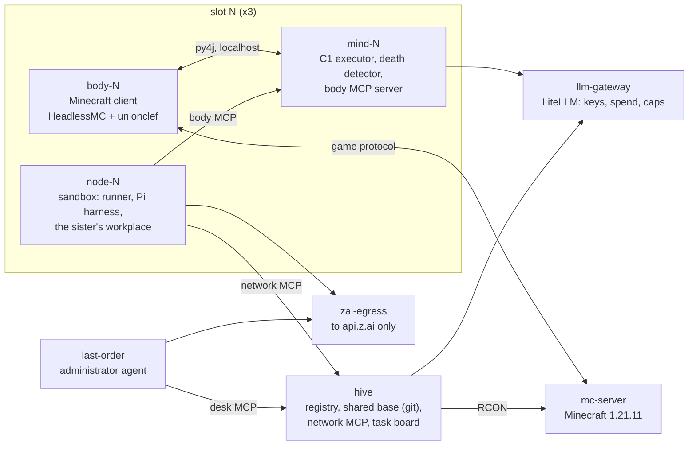

# Last Order

Last Order is a collective mind that lives in one Minecraft world: a network of short-lived
agents ("sisters"), each driving one player, each dying and leaving a will that the next one reads.
It is a course project (an 8-lesson course on building AI characters) and is under active
development.

A sister plays for at most 45 minutes. When she dies, by a creeper, by lava or by the clock, she
writes a will, her workplace is archived, and a new sister with new traits is born in the same
player slot. She reads the shared knowledge base and the wills of her predecessors, then decides
for herself what to do. A separate administrator agent, Last Order, accepts or rejects what the
sisters propose for the shared base and sets the network's goals.

## What you see

- Three players, `LastOrder01..03`, on one persistent server. Each is a slot; the sister in it
  changes with every life. A sister calls herself by her serial: `узел 00155` ("node 00155").
- Sisters talk in game chat in Russian, message each other, take tasks from a task board and
  refuse them with a reason when they disagree.
- The operator talks to Last Order and to each sister in a web chat ([HAPI](https://www.npmjs.com/package/@twsxtd/hapi))
  and posts tasks on the board. Chat, voice and other sisters' messages are observations, never
  commands: the agent decides.

## Status

| Area | State | Evidence |
|---|---|---|
| 3 slots in Docker, birth → life → death → will → rebirth | works | [MVP run 2](docs/agents/runs/2026-10-24-mvp-2.md): 12 births in 2 h |
| Spend | $0.06/h for 3 sisters via the gateway, cap $0.35/h, plus a Z.ai coding plan quota | same run |
| MVP criteria (8) | 6 pass, 2 fail: the heir names her predecessors in 58 % of lives (target 70 %), and 6 will sessions timed out | same run |
| Wills | every death left a will, but 11 of 12 were emergency wills assembled by the runner; the cause was found and fixed (T-040), not re-measured | same run |
| Operator board and chat with a live sister | works | [board/chat run](docs/agents/runs/2026-10-31-board-chat.md): 6 of 6 criteria, the life-length limit was exceeded on the operator's call |
| Sisters and Last Order on the Pi harness | merged, not yet re-run as a full MVP run | ADR-041, T-066, T-059 |
| Request size of a sister | median 29k tokens; cut in T-056 to an estimated 18k, not yet measured on the stand | [context report](docs/agents/runs/2026-11-07-context.md) |
| Body camera and video, voice, Telegram | planned | ADR-045, ADR-030, ADR-041 |

## How it fits together



The code is the environment: the body, fast reflexes, storage, the life clock and the safety
nets. Behaviour lives in instructions and in each sister's own files, which she may edit
(ADR-032). Details, with the decisions behind them: [docs/architecture/OVERVIEW.md](docs/architecture/OVERVIEW.md).

## Repository map

| Path | What |
|---|---|
| `runtime/` | Python: `mind/` (C1, body MCP), `node/` (runner, harness adapters, workplace), `hive/` (registry, base, MCP, board), `perception/` (game names), `lastorder/` (traits, will) |
| `docker/` | `compose.yml` and images: body, mind, node, hapi, egress, gateway |
| `agent/last_order/` | the sister template: manual, persona, session prompt, will prompt, personality core |
| `agent/network/` | Last Order's workplace template |
| `agent/shared/`, `agent/scripts/`, `tools/` | the [agent-workplace](docs/agent-workplace.md) template this repo is forked from |
| `docs/architecture/` | architecture, ADRs (`DECISIONS.md`, in Russian), the knowledge model |
| `docs/agents/` | development notes, run reports, the task protocol and task files (in Russian) |
| `tests/` | pytest, about 930 tests; they run without the stand |
| `unionclef/`, `NetTyan/` | links to other repositories: the Minecraft mod and a reference project |

## Running the stand

Requirements: Docker Desktop (tested on Windows with WSL2, 24 GB RAM), Git Bash, [uv](https://docs.astral.sh/uv/),
a Z.ai coding plan key for the harness. One body needs about 1.2 GB of RAM, the server about 1.5 GB.

```bash
uv sync                                          # tests: uv run pytest
uv run python dev/stand_keys.py init             # local tokens into .env (names only are printed)
# put ZAI_API_KEY (and OPENROUTER_API_KEY for the gateway) into .env yourself
bash docker/gateway/up.sh                        # LiteLLM gateway and its database
uv run python dev/stand_keys.py issue            # virtual gateway keys into .env
bash docker/node/up.sh                           # the whole stack
```

The first start of a body downloads about 540 MB of game assets (around 4 minutes). Watch the
world with your own client at `localhost:25565` (offline mode); the HAPI chat is at
`http://127.0.0.1:3006`. The full recipe, the risks and the restart order are in
[docs/agents/docker-topology.md](docs/agents/docker-topology.md) (Russian).

## How it is built

Two coding agents work on it under a written protocol: a worker (ZCode on GLM) writes code and
tests for one task at a time, and Claude Code plans tasks, reviews every result against a
checklist, and merges (ADR-019, ADR-040, ADR-046). The protocol is
[docs/agents/coop-protocol.md](docs/agents/coop-protocol.md), and every task with its report and
review is under `docs/agents/work/`.

## Credits and license

- [agent-workplace](https://github.com/3ndetz/agent-workplace) by 3ndetz: the template for the
  workplaces of the sisters and of Last Order. MIT, see [LICENSE](LICENSE).
- [unionclef](https://github.com/3ndetz/unionclef): the Minecraft client mod the bodies run
  (GPL-3.0). This repository only links to it; the release jar is downloaded at image build time.
- [NetTyan](https://github.com/3ndetz/NetTyan): a reference for ideas (MIT), not run here.
- [HAPI](https://www.npmjs.com/package/@twsxtd/hapi) for the operator chat (AGPL-3.0, run unmodified),
  [Pi](https://github.com/earendil-works/pi) as the agent harness, [LiteLLM](https://github.com/BerriAI/litellm) as the gateway,
  [itzg/minecraft-server](https://github.com/itzg/docker-minecraft-server) for the server.
