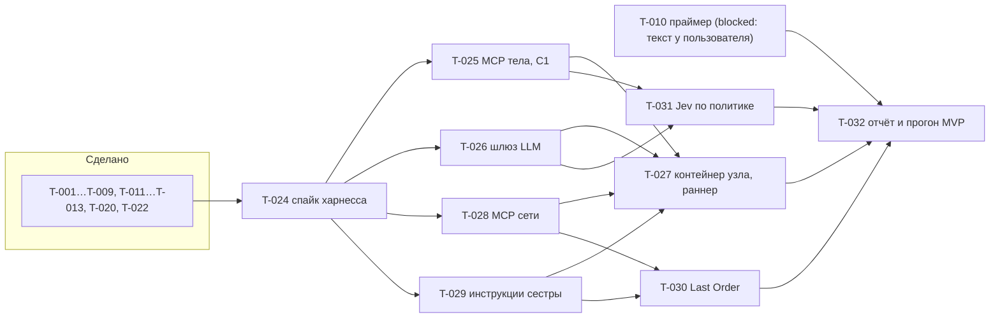
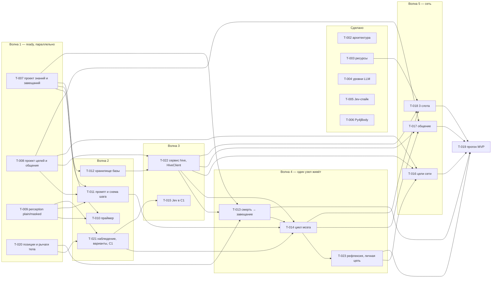

# План работ: MVP «сеть узлов Last Order»

Статус: утверждён к старту по команде пользователя. Решения — [open-questions.md](open-questions.md),
топология — [docker-topology.md](docker-topology.md), память — [KNOWLEDGE.md](../architecture/KNOWLEDGE.md).

## Пересмотр 2026-10-26: интерактивная сеть (этап I, ADR-041)

Решение пользователя: общаться с Last Order, сёстрами и сетью в одной веб-консоли (голос и мысль),
сеть сама строит свои инструменты (мастерская, гранты), харнесс — Pi на Z.ai Coding Plan. Задачи
T-040…T-047 (BOARD). Чаты ZCode: [T-040, T-041] → [T-042, T-043, T-044] → [T-045, T-046, T-047].
Первый разговор с Last Order в браузере — после T-044.

Уточнение 2026-10-26 (ADR-042): консоль — HAPI, «мысль» снята, задачи и запросы — доска в hive.
Доска — `docs/architecture/TASKBOARD.md`. Порядок: T-042 (доска), T-044 (HAPI) → T-048
(misaka-link), T-049 (страница доски) → T-043, T-046 (гранты) → T-045 → T-047.
Первый разговор с Last Order в HAPI — после T-043. Сценарий «Last Order строит Telegram» —
игра оператора после T-047, не задача.

## Пересмотр 2026-10-17: агент в харнессе

Узел и сеть стали агентами в сменном харнессе (OpenCode или ZCode) поверх рабочего места aw.
Решения — ADR-032…037, архитектура — [NETWORK.md](../architecture/NETWORK.md) v2. Требования R1–R7
не изменились: R3 закрывается только режимом `plain` (ADR-037), R4 закрывает инструкция и потолок шлюза
(ADR-035), R6 обеспечивают C0 и C1 в коде, а медленные контуры отданы агенту (ADR-032). Задачи
старой схемы T-014…T-019, T-021, T-023 сняты (`rejected`). Готовые модули среды используются как
есть.

## Пересмотр 2026-10-16

Требования пользователя:
- R1. Запустить в мир несколько узлов и дать им развиваться. Продумать контур целеполагания для сети
  и узлов (ADR-021: цели сети — совет, личную цель выбирает узел).
- R2. Модуль завещаний; модуль сохранения и определения знаний.
- R3. Не маскировать игру; основы Minecraft — базовые знания сети (ADR-020: `plain` по умолчанию,
  праймер, `masked` остаётся режимом).
- R4. Общение узлов: для развлечения и для координации (ADR-022).
- R5. Снизить расходы и ресурсы клиентов и сервера.
- R6. Разнести работу узлов и сети по контурам с разной скоростью (ADR-001, ADR-023).
- R7. Прочее из брифа и переписок: прозвища, ритуалы из совпадений, споры с предшественниками,
  личные термины поверх настоящих имён, срок жизни и застревание, эпохи и сброс мира, сон и
  бодрствование, «сновидец», роли узлов (антрополог, кочевник…), режиссёр камеры и стрим (2-я итерация),
  Telegram и автопосты хроники, публичный сервер из whitelist (ADR-013), метрики поколений.

LLM (ADR-023): `node` и `smart` — дешёвое облако, выбор по замеру T-004 (шорт-лист с ценами — в задаче);
`jev` — облачный Jev, FastJev на RTX 2070 — запасной (T-005, ADR-027). Ориентир — ≤ $0.25/ч на 3 узла.

Порядок работ. Проектирует и пишет код ZCode, проверяет и мержит Claude (ADR-019). Задачи — BOARD.
Граф ниже — история старой схемы; действующий граф — в «Пересмотре 2026-10-17».

Все задачи описаны окончательно (2026-10-17). Статус `queued` снят ADR-040: задача `ready` с полем `after:`
берётся, когда задачи из него `done`. Разделы «Цикл мозга» и шаги E2–E4 ниже — история плана 2026-10-14; где они расходятся с
задачами T-002…T-019, верны задачи.

## Критерий MVP (занятие 4, запас до 5; пересмотр 2026-10-17)
2–3 слота в одном мире работают **2 часа без вмешательства**, и за это время:
- сменилось ≥6 поколений узлов, у каждого свои черты в `birth.json` и в рабочем месте;
- ≥70% новых узлов в первых 3 репликах ссылаются на запись предшественника: номер, термин или урок
  (автопроверка по базе);
- ни одной смерти без `will.md`;
- агенты живут без вмешательства: нет зависших сессий без перезапуска раннером, расход — в потолке
  шлюза (≤ $0.35/ч на 3 узла деньгами плюс квота);
- служебные строки uc не попадают агенту (по логам харнесса);
- сёстры пользуются самоправкой: у каждой есть записи в своей памяти, у сети — хотя бы одно принятое
  Last Order предложение.

Отчёт выдаёт отчёт MVP (T-032) по volume `knowledge`, `workplaces` и логам шлюза.

## Цикл мозга (история, схема до 2026-10-17)
Раз в 8–15 с или по событию (урон, новый объект, сообщение в чате):
1. `observe()`: `getGameState`, `getEntitiesInfo(16)`, `getBlocksAround(4)`, `getInventoryFull`,
   `getRecentChat(5)` → perception (id → handle + описание/термин) → компактный JSON.
2. `options()` — код строит ≤8 вариантов:
   - подойти к handle, ударить handle, добыть handle;
   - отойти от угрозы, осмотреться, ждать, поставить, съесть.
   Варианты исполняются рычагами uc. `@gamer` не даём.
3. Один вызов LLM, ответ в JSON: `{option, why, say?, new_term?, note?, votes?}`.
   - Порядок промпта под кеш: личность и каталог (статично) → core memory → знания о видимых handle-ах →
     наследие → кандидаты на голос → наблюдение.
4. `act()`:
   - результат → `log.jsonl`;
   - `say` → игровой чат с лимитом частоты, в манере пресета (ADR-018);
   - `new_term`, `note`, `votes` → hive.
5. Смерть определяется по hp = 0 в `getGameState` и ванильной строке смерти в чате (проверено в E1). Далее:
   1. вызов «рефлексия + завещание»;
   2. `will.md`;
   3. `hive.retire`;
   4. `respawnPlayer()`: авторесп uc без задачи не срабатывает;
   5. `hive.birth`.
   Если LLM упала — аварийное завещание из шаблона.
6. Сбои: таймаут вызова, пауза с растущей задержкой, после трёх сбоев узел «ждёт». Цикла без пауз нет.

Порты по ARCHITECTURE §5.3: `GameBody` (`Py4jBody`), `PersonaProvider`, `Memory` (`HiveKnowledge`).
Потом C1, Redis и FastJev встают за те же интерфейсы.

## Шаги

### R1. Перестройка репозитория (первым делом, по команде)
- [x] `git branch -m master main`
- [x] удалить сабмодуль aw: `git submodule deinit -f agent-workplace`, `git rm -f agent-workplace`, `rm -rf .git/modules/agent-workplace`
- [x] `git remote add upstream https://github.com/3ndetz/agent-workplace.git && git fetch upstream`
- [x] `git merge upstream/main --allow-unrelated-histories` (или первый коммит наших файлов, затем merge)
- [x] `unionclef` зафиксировать на `v0.95.59`; `.gitmodules` с `branch`/`shallow` по желанию
- [x] NetTyan: правки пользователя — в локальную ветку nt или `stash` (с подтверждением)
- [x] `docs/context/` ← переписки; удалить корневой `LAST_ORDER.md`; `.gitignore` (`.github/modernize/`, `.env`, `__pycache__`, `run/`)
- [x] первый коммит; CLAUDE.md — убрать абзац «Состояние репозитория: сейчас…»

### R2. Документы-решения
- [x] DECISIONS.md: ADR-015 (Docker), ADR-016 (сеть сразу), ADR-017 (Мисака-нет, hive — единственный писатель), ADR-018 (имя слота и имя узла)
- [x] бриф LAST_ORDER.md §1, §5, §7: ссылки на новые ADR, имя «Мисака NNNNN», манера речи
- [x] `prompt_template.md`: имя и манера речи — плейсхолдеры, пресеты `lab` / `misaka` (ADR-018). task1.md не трогаем — это сданная домашка

### E0. Каркас (до занятия 2)
- [x] `agent/last_order/`: PERSONA (operator-часть = база), SESSION_PROMPT, GOALS, `memory/`, `prompt_template.md`
- [x] `aw-fix:` `AGENT_NAME`, проверка аргументов скриптов
- [x] `pyproject.toml` (uv, Python 3.12): litellm, py4j, fastapi, uvicorn, pydantic, pytest
- [x] `runtime/lastorder/traits.py` и `naming.py`: черты, quirk, seed, пресеты имени; `persona.py`: подстановка, проверка «нет пустых `{}`»
- [x] `runtime/llm/client.py`: LiteLLM, JSON-ответ, таймаут, повтор, опция reasoning off
- [x] `runtime/perception/`: таблица описаний (пустой шаблон для пользователя), handle = хэш id с солью эпохи, обратная карта
- [x] тесты: черты, промпт, perception (регулярка `minecraft:` и словарь id → 0 вхождений)
- [x] снапшот трёх запросов из task1 на облачной модели: `docs/agents/snapshots/`
- [ ] выбрать локальную модель и добавить `docker/llm` (vLLM) — перенесено в E2

### E1. Тело в Docker — спайк главного риска (до занятия 2)
- [x] `docker/body/Dockerfile`: Java 21, HeadlessMC, Fabric 1.21.11, fabric-api, jar uc (sha256), `altoclef_settings.json` (autoConnect, autoRespawn)
- [x] `docker/compose.yml`: `mc-server` + `body-1` + `mind-1` (network_mode)
- [x] из `mind-1` (`tools/body_probe.py`): `inGame`, геттеры, `gotoXYZ` + `pathStatus`, `@get log 1`, RCON `/kill`,
  `respawnPlayer()`, callback `onChatMessage`. Находки — в unionclef-bridge.md, раздел «Py4J: проверено в E1»
- [x] без GL работает; вариант Xvfb остаётся в образе (`BODY_RENDER=xvfb`) для показа

### E2. Один мозг (занятие 2)
- [ ] локальная модель: `docker/llm` (vLLM), профиль `local`
- [ ] `runtime/game/py4j_body.py` (`GameBody`), `options.py`, `death.py`
- [ ] `runtime/lastorder/mind.py`: цикл, реплики, завещание, аварийное завещание
- [ ] `runtime/hive/`: birth/retire/summary, `knowledge/store.py` (записи, git-коммит на изменение)
- [ ] проверка: узел живёт до смерти или 45 мин, `will.md` в базе, следующий узел ссылается на него

### E3. Сеть (занятие 3) — критерий MVP
- [ ] `body-2`, `body-3`, `mind-2`, `mind-3`; сквозные номера из hive
- [ ] ротация: смерть, срок жизни, застревание; сводка живых и мёртвых
- [ ] минимум памяти: завещания + термины + `note` как `hypothesis`; знания по видимым handle-ам в промпте
- [ ] `tools/mvp_report.py`; 2-часовой прогон

### E4. Память сети (занятие 4)
- [ ] рефлексия раз в 5–10 мин, core memory, кандидаты, дедуп, попутное голосование, статусы
- [ ] метрики поколений: время жизни, подтверждённые знания, вехи

### Дальше — по task2.md
Шаги E2–E4 выше — история; с 2026-10-17 работы идут по графу «Пересмотра 2026-10-17».
- Занятие 3: канал хроники в Telegram (ADR-030).
- Занятие 4: MVP; спайк голоса узлов (TTS → Simple Voice Chat).
- Занятие 5: общие навыки через Last Order (ADR-031, ADR-034), голос в игре, публичный сервер из whitelist (ADR-013).
- Занятие 6: агент-режиссёр, тело-камера, OBS; автозапуск, сон и бодрствование; сновидец — опция.

## Проверка на каждом шаге
`uv run pytest`, `python tools/check.py`, `docker compose -f docker/compose.yml up`, `tools/mvp_report.py`.
