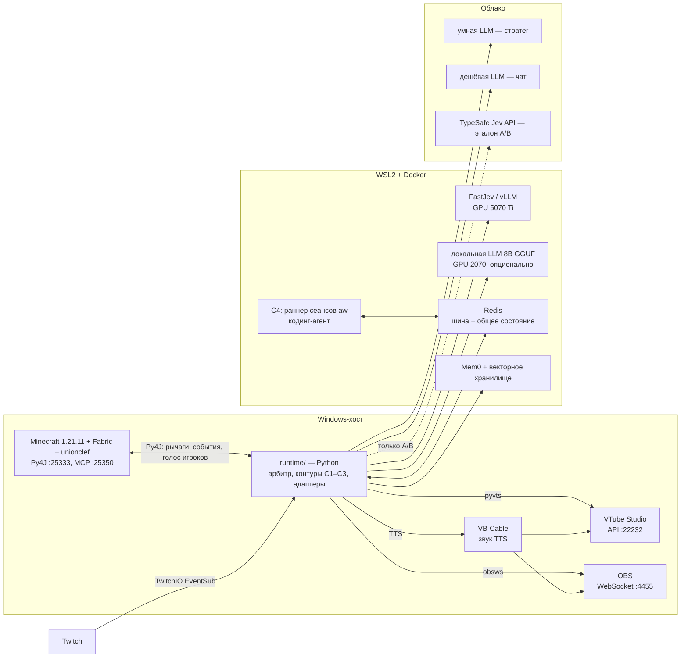
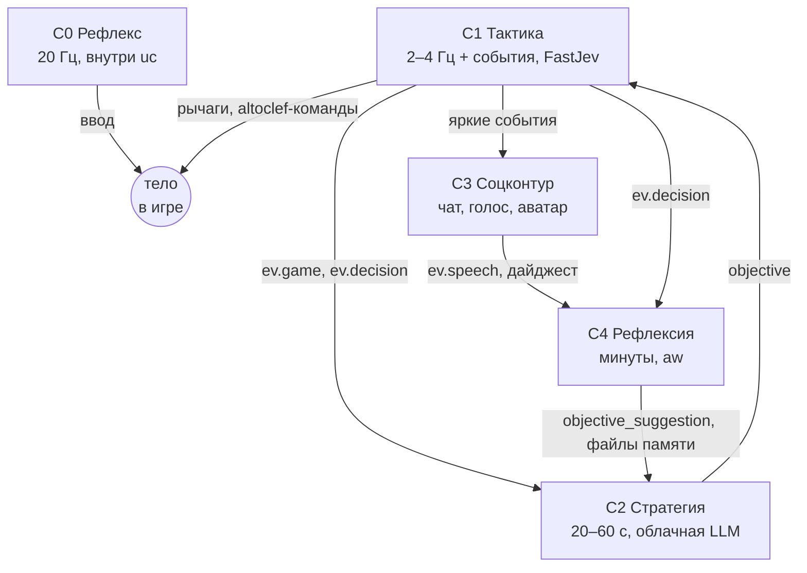

# Архитектура агента-стримера-геймера

Статус: **зафиксировано**, версия 1.0 (2026-10-10). Решения и их обоснование — в
[DECISIONS.md](DECISIONS.md), этапы и критерии — в [ROADMAP.md](ROADMAP.md).
Сеть узлов Last Order описана отдельно: [NETWORK.md](NETWORK.md).

Пометки: **[проверено: путь]** — прочитано в коде; **[источник]** — внешний материал, не запускался;
**[предположение]** — проверяется на этапах дорожной карты.

Сокращения репозиториев: `aw` — 3ndetz/agent-workplace, `uc` — 3ndetz/unionclef,
`nt` — 3ndetz/NetTyan (только как источник идей), `mca` — rmalde/minecraft-agent (PoC).

---

## 1. Цель и приоритеты

Персонаж хорошо и быстро играет в Minecraft и одновременно ведёт стрим: говорит голосом,
реагирует на чат и на голос игроков, управляет VTuber-аватаром.

1. Качество и скорость игры.
2. Совместимость со стеком курса: Minecraft 1.21.11 + Fabric + `uc`, VTube Studio, OBS.
3. Личность и промпт персонажа — **вне скоупа**, только интерфейс-заглушка `PersonaProvider`.

Режим на старте — выживание. PvP добавляется позже как отдельный набор вариантов для тактики.
VLA не используется.

## 2. Контекст системы



Python-рантайм живёт на Windows: аудиоустройства и колбэк-сервер Py4J (Java → Python) не
пересекают границу WSL. В WSL — только инференс и инфраструктура. См. ADR-007.

## 3. Контуры



| Контур | Частота / бюджет | Вход | Выход | Компонент | Сбой / таймаут |
|---|---|---|---|---|---|
| **C0 Рефлекс** | 20 Гц тик, ≤50 мс | Тик игры | Ввод мыши и клавиш | Внутри мода `uc`: уклонение от стрел, ночное убежище, позже `@punk` [проверено: uc/README.md, Features] | Мод упал → перезапуск клиента, событие `game.down`, остальные контуры на паузе |
| **C1 Тактика** | По событию + опрос 2–4 Гц. Решение ≤150 мс p95, действие асинхронно | Компактное состояние (`getGameState`, `getInventoryFull`, последние события, цель) + ≤16 вариантов | Один рычаг или altoclef-команда + распределение + уверенность → `ev.decision` | FastJev Qwen3.5-4B на vLLM (5070 Ti); Py4J [проверено: uc/docs/features/AGENT_PY4J_LEVERS.md] | Таймаут 250 мс → `RuleDecider` (продолжить задачу / `@gamer`). Уверенность < τ три раза подряд → запрос C2. Простой > 20 с → `stopPathing`, пересчёт вариантов |
| **C2 Стратегия** | Раз в 20–60 с или по триггеру; 2–8 с, асинхронно | Сводка мира, лестница прогресса, дайджест речи | `objective {goal, targets, constraints, deadline}` | Умная облачная LLM через LiteLLM | 15 с → прежняя цель, запасной провайдер. Три сбоя → C1 в `AUTONOMOUS` |
| **C3 Соцконтур** | Окно чата 1–3 с; от сообщения до первого звука ≤2.5 с p95; аватар 10–30 Гц | `ev.chat` (Twitch), `ev.voice` (речь игроков), яркие `ev.game`, общее состояние | Реплика (текст + эмоция) → TTS → VB-Cable → липсинк VTS; текст в игровой чат | Pipecat; дешёвая облачная или локальная 8B LLM; Silero TTS (CPU); GigaAM v3 ASR (CPU); pyvts; TwitchIO | Первый токен > 1.5 с → короткая заготовка/FX. TTS упал → текст в HUD/чат. ASR упал → голос игроков игнорируется |
| **C4 Рефлексия** | Между матчами / раз в 15 мин / после стрима | Дайджест: решения, смерти, цитаты чата и голоса, открытые цели | `memory/`, `GOALS.md`, предложения целей | Сеанс `aw` через раннер + кодинг-агент | Пропуск, повтор в следующем окне. Горячий путь не блокирует никогда |

Почему C2 и C4 разделены: разный ритм (секунды против минут) и разные права записи —
стратег пишет только цель, рефлексия пишет только память.

## 4. Арбитраж и прерывания

1. **Тело.** C0 главнее всех. C1 не перебивает идущий рефлекс (ждёт конца или ≤1 с).
   Телом управляет только C1. C2 задаёт цели и ограничения. C3 и C4 игровых команд не шлют.
2. **Владение.** Два режима:
   - `AUTONOMOUS` — работает `@gamer`, C1 наблюдает и перехватывает по триггерам (урон,
     простой, отклонение от цели);
   - `DIRECTED` — рычагами управляет C1.

   Переключение атомарное: `stopPathing()` → `hasActiveTask() == false` → смена режима
   [проверено: AGENT_PY4J_LEVERS.md].
3. **Перепланирование C2:** цель выполнена или провалена, смерть, простой > 60 с,
   серия решений с низкой уверенностью.
4. **Чат и голос не влияют на игру.** C1 и C2 не подписаны на `ev.chat` и `ev.voice`.
   Инъекция из чата в игру невозможна по построению.
5. **Приоритет речи:** опасность / смерть (прерывает текущую фразу, ≤1 фраза) >
   обращение игрока голосом / донат / модератор > ответ в чат > комментарий к игре >
   заполнение тишины.
6. **Отбор реакций в чате:** упоминание имени, вопрос, первое сообщение зрителя, донат,
   модератор. Не чаще 1 ответа в 15 с, остальное — общие реплики.
7. **TTL реплик:** комментарий к игре 3 с, ответ в чат 20 с, ответ игроку голосом 10 с.
   Перед воспроизведением проверяется `ref_event` (план ещё активен?). Устаревшая реплика
   выбрасывается. В память пишется только воспроизведённое (`ev.speech`).
8. **C4** влияет на матч только через `objective_suggestion`, которое принимает C2.
   `GOALS.md` из чата не пишется — только от оператора.

## 5. Интерфейсы

### 5.1. Конверт событий (Redis Streams)

```json
{"id": "…", "ts_mono": 0, "ts_wall": "ISO-8601", "source": "c1", "type": "game.damage",
 "priority": 0, "ttl_ms": 0, "ref": "…", "payload": {}}
```

| Поток | Писатель → читатели | Содержимое |
|---|---|---|
| `ev.game` | Мост Py4J, C1 → все | урон, смерть, убийство, предмет, простой. Источник — колбэки `onDamage`, `onDeath`, `onKill`, `onAutoclefEvent` [проверено: uc/src/main/java/adris/altoclef/PythonCallback.java] |
| `ev.voice` | Мост Py4J → C3 | сегменты речи игроков после VAD + текст ASR. Источник — `onVoiceFeed(playerName, PCM16LE)` [проверено: uc/…/util/agent/VoiceChatIntegration.java] |
| `ev.chat` | TwitchIO, игровой чат → C3 | сообщения после фильтра спама |
| `cmd.objective` | C2 → C1 | цель |
| `ev.decision` | C1 → C2, C4, метрики | состояние, варианты, распределение, результат |
| `cmd.speech` | C1/C2/C3 → планировщик речи | реплика с TTL и `ref` |
| `ev.speech` | планировщик речи → C4, память | факт воспроизведения |
| `ev.health` | сторожа → все | состояние компонентов |

### 5.2. Общее состояние (Redis, один писатель на ключ)

| Ключ | Писатель |
|---|---|
| `world` | C1 |
| `ownership` | C1 |
| `objective` | C2 |
| `speech_state` | C3 |
| `server` | мост Py4J (по `onUpdateServerInfo` / `getServerInfoDict` [проверено: Py4jEntryPoint.java]) |
| `stream_digest` | C3 → читает C4 |

### 5.3. Порты (Python `Protocol`)

| Порт | Методы | Реализации |
|---|---|---|
| `GameBody` | `state()`, `act(lever, args)`, `stop()`, `busy()`, `server()` | `Py4jBody`, `McpBody` |
| `Decider` | `choose(state, options) -> (option, probs, conf)` | `FastJevDecider`, `TypeSafeJevDecider`, `RuleDecider` |
| `Planner` | `plan(summary) -> Objective` | `LiteLLMPlanner` |
| `Listener` | `segments() -> AsyncIterator[VoiceSegment]` | `GigaAMListener` |
| `Voice` | `say(utt, ttl, ref)`, `interrupt()` | `PipecatVoice` (Silero / CosyVoice) |
| `Avatar` | `emote(name)`, `gaze(x, y)` | `PyvtsAvatar` |
| `Memory` | `recall(person_ids, k)`, `note(person_id, fact)` | `Mem0Memory`, `FilesMemory` |
| `PersonaProvider` | `system_prompt(ctx) -> str` | **заглушка**: PERSONA через `compose_session` |

## 6. Память

| Слой | Где | Пишет | Что |
|---|---|---|---|
| Личность | `agent/<char>/PERSONA.md` | человек | ядро персонажа (вне скоупа) |
| Состояние | `memory/state.md` | C4 | настроение, открытые нити; жёсткий лимит размера |
| Люди (отобранное) | `memory/entities/<id>.md` | C4 | выжимка о человеке, ссылки |
| Люди (быстрое) | Mem0 | C3 | факты и реплики, поиск за миллисекунды |
| Матч | Redis | C1/C2/C3 | живое состояние, удаляется после матча |
| Цели | `GOALS.md` | C4 (от оператора) | долгие цели |

Модель человека `person`: `kind: viewer | player`, `ids: [twitch:<login>, mc:<nick>@<server>]`,
`trust`, `first_seen`, `notes`. Ник на офлайн-серверах не подтверждён, поэтому ключ игрока —
пара (сервер, ник) [предположение]. В промпт C3 попадают ≤3 человека из текущего разговора.

При расхождении Mem0 и файла выигрывает файл. Приватность: правила `aw` (не раскрывать чужие
данные), команда «забудь меня», срок хранения для игроков с публичных серверов. Голос хранится
только как короткие факты, сырой звук не сохраняется.

## 7. Серверы

- **Whitelist** хостов в конфиге. Проверяется рантаймом перед `ConnectToServer` и по
  `onUpdateServerInfo`. Хост не в списке → C1 и C2 выключены, бот только наблюдает,
  событие `server.denied`.
- **Профиль `local`** (помечается явно): RCON-метрики, воспроизводимые сиды.
- **Профиль `public-safe`** (все остальные хосты из whitelist): без серверных сенсоров и команд,
  ограничение скорости камеры (повороты только через mouse-pipeline `uc`
  [проверено: AGENT_PY4J_LEVERS.md]), ограничение частоты сообщений бота.

## 8. Развёртывание и GPU

| Ресурс | Нагрузка | Комментарий |
|---|---|---|
| RTX 5070 Ti 16 ГБ | клиент Minecraft, FastJev (vLLM, `gpu_memory_utilization ≈ 0.5`), NVENC для OBS | цифры VRAM — [предположение], этап 0 |
| RTX 2070 8 ГБ | локальная LLM 8B GGUF Q4 **или** CosyVoice3 | одновременно не помещаются [предположение]; vLLM на Turing не используем |
| CPU | Silero TTS, GigaAM ASR, Redis, Mem0 | GPU не требуется |

Контейнеры привязаны к картам через `device_ids`, не `count: all`.

## 9. Отказы и деградация

| Отказ | Поведение |
|---|---|
| FastJev | `RuleDecider` → `@gamer` в `AUTONOMOUS` |
| Облачная LLM стратега | прежняя цель, запасной провайдер, затем `AUTONOMOUS` |
| LLM чата | заготовки, FX, переход на запасную (облако ↔ локальная) |
| TTS | текст в HUD и игровой чат |
| ASR | голос игроков игнорируется, событие в `ev.health` |
| Py4J | пауза C1/C2, переподключение с растущей задержкой, реплика «лаг» |
| Redis | рантайм останавливает контуры, кроме C0 (мод играет сам) |
| Смерть в игре | событие всем, C2 перепланирует |

Каждый контур — свой процесс со сторожем и растущей задержкой перезапуска. Бесконечных циклов
`try/except` без паузы нет.

## 10. Наблюдаемость

- **Игра:** время до вех (дерево, каменные и железные инструменты, …), смерти в час, доля
  простоя (по образцу `uc/deploy/runner/deadtime.py` [проверено]), задержка решения p50/p95,
  доля откатов на правила, доля решений с низкой уверенностью.
- **Стрим:** от сообщения до звука p50/p95, доля отвеченных, доля выброшенных реплик, WER ASR,
  потери голосовых пакетов.
- **Система:** свободная VRAM по картам, FPS клиента, обрывы трансляции.
- **Журнал решений** в формате `events.jsonl` по образцу PoC [проверено: mca/README.md] —
  он же служит набором данных для A/B Jev.

## 11. Структура репозитория

Форк `aw` (upstream-remote сохраняется, правки отдельными коммитами `aw-fix:` / `aw-ext:`):

```
agent/
  AGENTS.md, shared/          upstream + новые shared/game.md, shared/stream.md
  scripts/                    upstream-скрипты с проверкой аргументов + objective.sh, note.sh, digest.sh
  <char>/                     персонаж по форме vesper; PERSONA — заглушка
tools/
  compose_session.py          + лимит UNANSWERED, ISO-время, секция --live
  check.py                    + тесты обхода путей, жёсткий лимит state.md
runtime/
  bus/ blackboard/            Redis Streams, общее состояние
  game/                       Py4jBody, варианты, TacticalLoop, сторож, владение, whitelist
  strategy/                   Planner, лестница прогресса
  social/                     Pipecat, TwitchIO, pyvts, планировщик речи, ASR
  memory/                     Mem0, синхронизация с entities/
  workplace/                  раннер C4, учёт delivered_ids
  metrics/                    журнал решений, дашборд
docker/                       compose.{fastjev,llm,redis,mem0}.yml
docs/architecture/            этот документ, решения, дорожная карта
```

## 12. Открытые вопросы

| # | Вопрос | Значение по умолчанию до ответа |
|---|---|---|
| Q1 | Бот отвечает игрокам только текстом или нужен голос в игре? | Текст в игровой чат + голос на стрим; голос в игре — эксперимент этапа 4b |
| Q2 | Когда бот слушает игрока? | По имени или обращение ближайшего игрока в радиусе 8 блоков |
