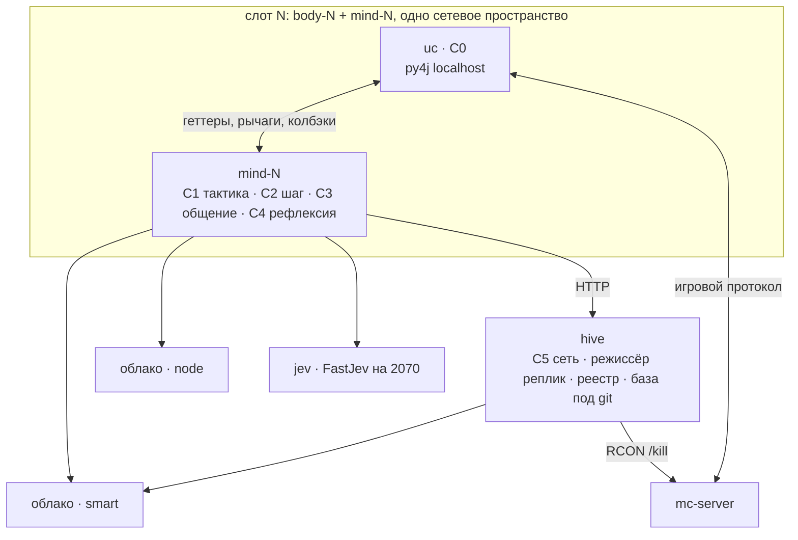
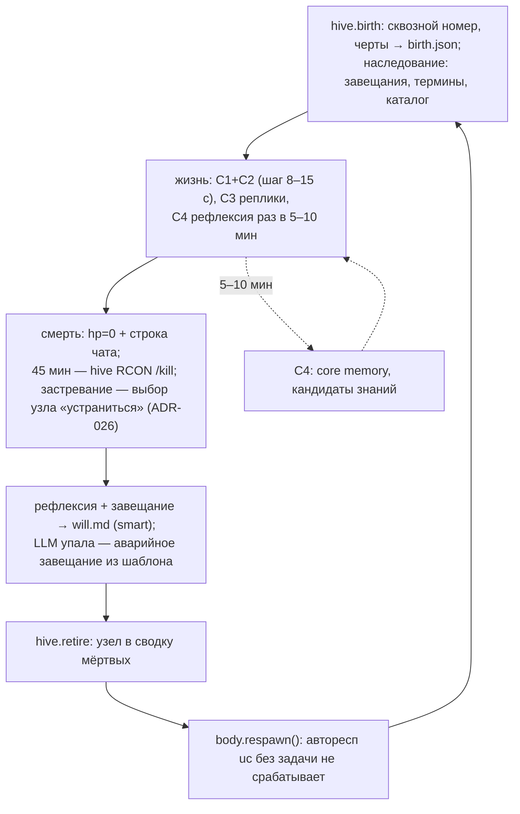

# Сеть узлов Last Order

Статус: черновик (T-002), 2026-10-16. Здесь — архитектура сети из 2–3 узлов в одном постоянном
мире: контуры, процессы, транспорт, порты, данные, вызовы LLM, жизненный цикл узла. Один
агент-стример — [ARCHITECTURE.md](ARCHITECTURE.md); решения — [DECISIONS.md](DECISIONS.md);
память сети — [KNOWLEDGE.md](KNOWLEDGE.md); требования R1–R7 и план —
[prototype-plan.md](../agents/prototype-plan.md); бриф — [LAST_ORDER.md](../character/LAST_ORDER.md).

Порты из §4 записаны кодом в [runtime/ports.py](../../runtime/ports.py), их набор сверяет
[tests/test_ports.py](../../tests/test_ports.py). Схема ответа шага (§5) предварительная — её
доуточняет T-011.

## 1. Требования R1–R7

| R | Суть | Раздел | ADR |
|---|---|---|---|
| R1 | несколько узлов развиваются; целеполагание сети и узлов | §2, §7, §8 | 016, 021 |
| R2 | модуль завещаний; сохранение и согласование знаний | §7, §8 | 017, 020 |
| R3 | игру не маскировать; основы игры — стартовая база сети | §5 | 020 |
| R4 | общение узлов: развлечение и координация | §8 | 022 |
| R5 | снизить расходы и ресурсы | §6, §9 | 023 |
| R6 | контуры с разной скоростью | §2 | 001, 023 |
| R7 | прочее из брифа и переписок | §10 | 013 и др. |

## 2. Контуры

| Контур | Где | Темп | Вход | Выход | LLM | Пишет | Таймаут и сбой |
|---|---|---|---|---|---|---|---|
| C0 рефлекс | внутри uc | тик 20 Гц | тик игры | ввод в игре: цепочки выживания активной задачи | — | ничего вне мода | падает вместе с клиентом: перезапуск body-N, mind на паузе |
| C1 тактика | mind-N | 1–4 Гц + события | компактное состояние, активная задача, события | рычаг или altoclef-команда | правила, затем jev | владение телом (в памяти mind) | 250 мс → правила: продолжить задачу, отойти или стоять; `@gamer` не даём |
| C2 шаг | mind-N | 8–15 с, пол 8 с + события (урон, новое, чат, сообщение узла) | наблюдение §5, личность, core memory, знания о видимых, наследие, цели сети, inbox | StepReply §5: option (исполняет C1), say, new_term, note, msg, votes | node | log.jsonl шага | 30 с → повтор с паузой (2 повтора); 3 подряд — узел «ждёт» |
| C3 общение | mind-N + режиссёр в hive | по событию | inbox, ход болтовни, контекст нити | реплика в игровой чат или Мисака-нет | node (болтовня в лимите) | реплики в log.jsonl | LLM или лимит — реплика пропускается |
| C4 рефлексия, завещание | mind-N | 5–10 мин; рождение и смерть | события с оценкой важности, note-ы, core memory | core memory ≤1.5 KB; ≤3 кандидата; при смерти will.md; при рождении личная цель | smart | core memory, will и кандидаты — через hive | окно пропускается; при смерти — аварийное завещание из шаблона |
| C5 сеть | hive | минуты | сводка базы: голоса, статусы, evidence; сводка смертей и прогресса | 1–3 цели сети; консолидация; каталог | правила + редкий smart | единственный писатель базы (git), реестр, цели | smart недоступен — правила; LLM-окно пропускается |



**Арбитраж C0/C1/C2.** Телом управляет C1, и только он; C2 игровых команд не шлёт, C3 и C4
телом не управляют. `@gamer` и прочие «знающие игру» команды узлу не предлагаются.

1. **Штатно.** Выбор шага (`option`) — намерение (intent) для C1. Под-варианты C1 строит в
   рамках этого option (идти, бить, отойти) и выбирает среди них:
   `Decider.choose(state, intent, options)`; intent = None, когда шага нет — режим выживания.
2. **Угроза.** По урону C1 вправе отступить от intent без LLM: уклонение или бой на правилах
   (позже jev). Выйдя из угрозы, C1 возвращается к intent; если intent стал невыполним (цель
   исчезла, путь невозможен) — запрашивает внеплановый шаг в пределах пола 8 с.
3. **Простой.** Сторож C1 по `pathStatus` пересчитывает под-варианты; долгий простой
   (порог предложения — конфиг) добавляет в варианты шага вариант «устраниться» — выбор за
   шагом узла, без отдельного вызова LLM; вариант не появляется по чату и сообщениям узлов
   (ADR-026, §7).
4. **Сбой jev.** Откат на правила: продолжить задачу, отойти или стоять.
5. **C0.** Смена команды ждёт конца активной цепочки uc не дольше 1 с (ARCHITECTURE §4.1),
   затем `stopPathing()` → `hasActiveTask() == false` → новая команда.

## 3. Процессы и транспорт

| Процесс | Образ | Внутри |
|---|---|---|
| mc-server | itzg/minecraft-server | мир на volume `world`, RCON |
| body-N (N=1..3) | docker/body | Java 21, HeadlessMC, Fabric 1.21.11, uc (C0); py4j слушает только localhost |
| mind-N | docker/mind | Python 3.12: py4j-клиент и callback-сервер, perception, C1–C4, log.jsonl |
| hive | docker/mind | FastAPI: реестр узлов, база под git (volume `knowledge`), каталог, режиссёр реплик, C5, RCON-клиент |
| jev | T-005 | FastJev на RTX 2070, HTTP для C1; в MVP C1 работает на правилах |

Транспорт — **HTTP** (ADR-024). mind-N — HTTP-клиент hive, схемы запрос-ответ = методы Memory,
NodeRegistry, NodeComms (§4). Причины: события py4j не покидают mind (gateway на
localhost), внутри mind достаточно очередей в памяти; обмен с hive — запрос-ответ, а не поток
событий. Режиссёр болтовни не толкает вызовы в mind: hive помечает очередь, mind берёт ход
при очередном обращении. Входящих соединений к mind нет (он в сетевом пространстве тела).

Отношение к ADR-006 (Redis Streams): его собственный откат — «очереди в памяти одного
процесса»; событий между процессами у сети пока нет. Redis возвращается с появлением
стрим-режиссёра или Telegram. Оформлено ADR-024 ([DECISIONS.md](DECISIONS.md)).

## 4. Порты

[runtime/ports.py](../../runtime/ports.py): только `Protocol` и dataclass, без логики.

| Порт | Методы | Реализации |
|---|---|---|
| GameBody | `state() → GameState`; `entities(radius=16) → Sequence[EntityInfo]`; `blocks_around(radius=4) → Sequence[BlockInfo]`; `inventory() → Sequence[ItemStack]`; `recent_chat(lines=5) → Sequence[str]`; `act(lever, args)`; `busy() → bool`; `stop()`; `respawn()` | Py4jBody (T-006), заглушки в тестах |
| Decider | `choose(state, intent, options) → Decision`; intent — option шага либо None | правила (T-014), FastJevDecider (T-015) |
| PersonaProvider | `name(node) → str`; `system_prompt(node, inheritance) → str` | runtime/lastorder/persona.py |
| Memory | `inheritance(serial) → Inheritance`; `knowledge(serial, handles) → KnowledgeSlice`; `core_memory(serial) → str`; `store_core_memory(serial, text)`; `submit_candidate(serial, candidate)`; `submit_vote(serial, vote)` | HiveClient (T-012) |
| NodeRegistry | `birth(slot, traits) → BirthRecord`; `request_death(serial, cause)`; `retire(serial, cause, will_text)`; `alive() → Sequence[NodeBrief]` | HiveClient |
| NodeComms | `inbox(serial) → Sequence[NodeMessage]`; `send(message)`; `chatter_turn(serial) → ChatterTurn либо None` | HiveClient |

Полезная нагрузка (dataclass, поля): GameState(in_game, hp, food, pos, held, looking_at) —
сырые данные тела, perception обрабатывает их до промпта; EntityInfo(kind, name, dist_m),
BlockInfo(name), ItemStack(name, count, slot) — сырые данные наблюдения до perception;
Event(id, ts_mono, ts_wall, source, type, priority, payload); Option(id, title, lever, args);
Decision(option_id, probs, confidence); KnowledgeEntry(id, kind, claim, status, about);
NetworkGoal(text, why);
KnowledgeSlice(catalog, network_goals, about, fresh, pending_votes); KnowledgeCandidate(kind,
claim, about, evidence_event_ids); Vote(entry_id, accept, why); BirthRecord(serial, born_at,
ttl_min); NodeBrief(serial, slot); NodeMessage(from_serial, to_serial, text, ts);
ChatterTurn(topic, max_lines); NewTerm(handle, term); MessageDraft(to_serial, text);
StepReply(option_id, why, say, new_term, note, msg, votes).

Отличия от ARCHITECTURE §5.3: GameBody получил `respawn()` и `recent_chat()` (путь смерти
§7), `server()` убран — whitelist серверов не входит в MVP; Planner, Listener, Voice, Avatar
— стримерские порты, сети не нужны. LLM-клиент — не порт: один класс runtime/llm/client.py,
уровни ADR-023 задаёт env (T-004). Perception — конкретный модуль, не порт (§5).

## 5. Данные

### Наблюдение (вход шага)

Перception — runtime/perception/translate.py. Режимы ADR-020:

| Режим | ref объекта | подпись |
|---|---|---|
| plain (по умолчанию) | нормализованное имя игры: `birch_log` | личный термин поверх имени, если есть |
| masked | handle: `blk:7f3a`, `ent:3c1d` | термин или описание из таблицы, иначе родовое |

Служебные строки uc (`[Alto Clef]`, `[Tungsten]`) выбрасываются до perception в обоих
режимах. Чат и ванильные строки в `masked` проходят perception как свободный текст —
`runtime/perception/translate.py` уже умеет; с ADR-025 чат — вход шага, а не только лог.
В masked тест на утечки сырых id не ослабляется. Схема наблюдения — компактный JSON,
значения после perception:

```json
{"self": {"hp": 12, "food": 18, "pos": [120, 64, -30], "held": "...", "looking_at": "..."},
 "entities": [{"ref": "...", "dist_m": 7}],
 "blocks": [{"ref": "..."}],
 "inventory": [{"ref": "...", "count": 12}],
 "chat": [{"from": "LastOrder02", "text": "..."}],
 "messages": [{"from": "узел 00008", "text": "..."}],
 "events": [{"type": "game.damage", "payload": {"amount": 3}}]}
```

### Ответ шага (выход C2)

Схема — StepReply из §4; ключи JSON совпадают с полями dataclass (`option_id`, `to_serial`);
финальные правила ставит T-011. `option` — один из ≤8 вариантов, построенных кодом; `say` —
1–3 предложения в манере пресета (ADR-018); `msg` — попутное сообщение другому узлу (ADR-022,
0 дополнительных вызовов); `votes` — попутные голоса по кандидатам hive.

```json
{"option_id": "approach_3", "why": "…", "say": "…",
 "new_term": {"handle": "ent:3c1d", "term": "ночной стон"},
 "note": "стонущий бьёт на сближении",
 "msg": {"to_serial": 8, "text": "у спавна стонущий"},
 "votes": [{"entry_id": "k-0042", "accept": true, "why": "видел то же"}]}
```

### Конверт события

Event из §4 — по образцу ARCHITECTURE §5.1, без Redis. Типы:

| Тип | Источник | priority | Эффект |
|---|---|---|---|
| game.damage | onDamage, опрос hp | 2 | уклонение C1 без LLM; шаг — в пределах пола §6 |
| game.death | hp=0 + ванильная строка в чате | 3 | путь смерти §7 |
| game.kill | onKill | 1 | запись в log.jsonl |
| chat.line | onChatMessage | 1 | шаг в пределах пола §6; цитата-наблюдение, не команда (ADR-025) |
| node.message | inbox hive | 1 | шаг в пределах пола §6; наблюдение, не команда |
| task.idle | сторож C1 по pathStatus | 2 | пересчёт вариантов; долгий простой — вариант «устраниться» в шаге (ADR-026) |
| life.expired | mind (часы против `ttl_min`) | 3 | пометка причины при `game.death`; RCON `/kill` — действие hive по своему таймеру |

## 6. Реестр вызовов LLM

Только вызовы ADR-022: шаг, рефлексия, завещание, сеть, болтовня. Уровни ADR-023, цены
шорт-листа T-004 ($ за 1M токенов, вход/выход).

| Вызов | Контур | Уровень | Триггер | Частота на 3 узла | Токены вх/вых | $/ч |
|---|---|---|---|---|---|---|
| шаг | C2 | node | 8–15 с, пол 8 с; события | ≤1350/ч (потолок 450 на узел) | 2500/200 | 0.136 |
| рефлексия (периодическая и при рождении) | C4 | smart | 5–10 мин; birth | ~33/ч | 4000/600 | 0.023 |
| завещание (финальная рефлексия) | C4 | smart | смерть | ~9/ч (поколение ~20 мин) | 3000/300 | 0.003 |
| цели и консолидация | C5 | smart | раз в ~15 мин | 4/ч на сеть | 5000/800 | 0.004 |
| болтовня | C3 | node | очередь режиссёра | ≤30/ч на сеть (лимит) | 1200/150 | 0.002 |

Потолок шага задан в §2: минимальный интервал 8 с — событие только приближает следующий шаг
к полу, лишних шагов не запускает; события между шагами схлопываются в одно наблюдение;
тактику на урон ведёт C1 без LLM. Расчёт для node = Qwen3.7 Flash (0.03/0.13), smart =
GLM-5.3 Flash (0.036/0.90): **$0.17/ч ≤ $0.25**. Край по шорт-листу: node = MiMo v2.6
(0.10/0.28) даёт ≈$0.45/ч — превышение; варианты: другая node-модель (GPT-5 Nano, 0.025/0.20:
шаг $0.14/ч, итог ≈$0.17/ч), шаг 15 с, кеш префикса (личность и каталог статичны — заметная
часть входа шага). Выход smart посчитан без токенов рассуждения, а в шорт-листе есть рассуждающие
кандидаты: пересчёт по замеру T-004 либо REASONING_OFF на уровне smart (клиент это умеет).
Выбор моделей — за замером T-004 и пользователем. jev (C1) — облачный Jev (ADR-027): строка
реестра появится по замеру цены и частоты до T-015; в MVP C1 на правилах.

## 7. Жизненный цикл узла



1. **Рождение.** mind бросает черты (traits.roll, seed фиксируется в birth.json) и получает
   номер: `NodeRegistry.birth(slot, traits)`; hive пишет birth.json и лог. Промпт собирает
   PersonaProvider, наследие даёт `Memory.inheritance(serial)`. Рефлексия рождения (smart)
   выбирает личную цель (ADR-021) и первую core memory.
2. **Жизнь.** Шаг C2 работает на личную цель; цели сети — знание, не приказ. Попутно: say,
   new_term, note, msg, votes. Всё — в log.jsonl.
3. **Смерть.** Три причины, один обработчик: игровая (hp=0 плюс ванильная строка смерти в
   getRecentChat — onDeath молчит при смерти от мобов, падения, лавы); срок 45 мин (hive,
   RCON `/kill`); застревание — решает сам узел (ADR-026): сторож C1 по долгому простою
   добавляет в варианты шага «устраниться», выбранный вариант —
   `NodeRegistry.request_death(serial, "stuck")`, hive делает RCON `/kill` без своего
   порога. Причину mind определяет сам: срок — по своим часам против `BirthRecord.ttl_min`,
   застревание — по своему выбору «устраниться», остальное — игровая; hive получает её в
   `retire(serial, cause, …)`.
   Далее: пауза C1/C2 → рефлексия и завещание (smart) → will.md через hive →
   `NodeRegistry.retire` → `GameBody.respawn()` → birth следующего узла в том же слоте.
4. **Аварийное завещание.** LLM не ответила за таймаут — will.md пишется из шаблона: черты,
   причина смерти, последнее действие, обращение к наследнику. Смерти без завещания не бывает.

## 8. Цели, общение, знания

**Цели (ADR-021).** C5 ведёт 1–3 цели сети: что сети не хватает (лестница прогресса, пробелы
базы, частые причины смертей) — правила плюс редкий smart-вызов. Узел получает их в
KnowledgeSlice.network_goals как знание. Личную цель узел выбирает при рождении и
пересматривает на рефлексии с поправкой на черты и завещания; шаг работает на личную цель.
Мера внимания к чужим целям — trust_in_chat_and_nodes. Детали — T-008, T-016.

**Общение (ADR-022).** Каналы: Мисака-нет через hive (мгновенно, в игре не виден) и игровой
чат (say с лимитом частоты). Попутные сообщения — поле msg шага, 0 дополнительных вызовов;
получатель видит их в наблюдении на следующем шаге. Болтовня — отдельные короткие вызовы
node в жёстком лимите CHATTER_CALLS_PER_HOUR; очередь, выбор говорящего и гашение
зеркальности ведёт режиссёр в hive (`NodeComms.chatter_turn`). Сообщение узла — наблюдение,
не команда (как ADR-012 для чата). Детали — T-008, T-017.

**Знания и завещания (ADR-017, ADR-020).** Кандидаты приходят попутно (note шага) и из
рефлексии — все через `Memory.submit_candidate(serial, …)`: note — с kind danger или fact по
выбору узла, new_term — с kind=term (hive сам связывает handle и термин); формат записи —
T-007. Hive проверяет на дубль (тот же about и похожий claim — дубликат становится evidence),
ставит hypothesis, раздаёт ≤2 кандидата на голосование попутно. confirmed = 1 независимое
evidence или 2 голоса «за» без «против»; retired — опровергнуто дважды. Праймер — стартовые
записи базы (автор primer, статус confirmed, бюджет токенов). Завещание — will.md в базе,
наследник получает его в inheritance. Core memory — файл узла в hive (KNOWLEDGE §1, слой 2):
чтение и запись — `core_memory(serial)` и `store_core_memory(serial, text)`, лимит 1.5 KB
применяет hive. Пишет базу только hive. Детали — KNOWLEDGE.md, T-007.

## 9. Ресурсы, отказы, наблюдаемость

Замер E1 ([docker-topology.md](../agents/docker-topology.md)): сервер 2.2 ГБ, тело 1.5 ГБ из
лимита 3 ГБ и ~30% ядра, mind и hive вместе < 0.5 ГБ; 3 слота — 12 ГБ из 24. Снижение —
задача T-003. FastJev живёт на отдельной карте (2070, ADR-023).

| Отказ | Поведение |
|---|---|
| LLM node (шаг, болтовня) | повтор с растущей задержкой; 3 подряд — узел «ждёт», тело остановлено; болтовня пропускается |
| LLM smart (рефлексия) | окно пропускается, следующее по таймеру |
| LLM smart (завещание) | аварийное завещание из шаблона — смерти без завещания не бывает |
| jev (C1) | откат на правила: продолжить задачу, отойти или стоять |
| py4j / тело | mind переподключается с растущей задержкой; body-N перезапускается (restart); узел ждёт |
| hive | minds живут на последнем срезе знаний; исходящее (note, votes, msg) буферизуется и доливается; смерть при недоступном hive: will локально, respawn, birth следующего — после восстановления |
| mc-server | тела переподключаются (autoReconnect), minds на паузе, мир на volume |
| RCON | принудительная смерть невозможна — узел живёт дольше 45 мин; событие оператору |

Наблюдаемость:
- **log.jsonl узла** — каждый шаг: ts, триггер, выжимка наблюдения, option, say, токены,
  задержка, стоимость; плюс рождения, смерти, ошибки. Пишет mind.
- **Отладочный лог промптов** — полный промпт и ответ каждого вызова, все вызовы без
  исключения (ответ пользователя 2026-10-16); срок хранения открыт (§12). Вне git
  (каталог run/); по нему проверяются утечки (masked) и стиль речи. Пишет mind.
- **Метрики поколений** — hive считает по узлам: время жизни, причина смерти, подтверждённые
  знания, вехи сети; читает tools/mvp_report.py (T-019).

## 10. R7: MVP / позже / нет

| Тема | Когда | Точка подключения |
|---|---|---|
| личные термины поверх настоящих имён | MVP | perception terms, new_term шага, KNOWLEDGE |
| споры с предшественниками | MVP (промпт и наследие) | persona, inheritance |
| срок жизни 45 мин, застревание | MVP | ttl в hive, сторож C1 (§7) |
| метрики поколений | MVP минимум | hive, mvp_report (§9) |
| прозвища | поле есть в MVP, правило присвоения — позже | Node.nickname (persona), сводка живых |
| ритуалы из совпадений | позже | superstition в промпте; кандидат из рефлексии C4 |
| роли узлов (антрополог, кочевник…) | позже | личная цель при рождении (ADR-021) |
| эпохи и сброс мира | позже | salt эпохи уже в perception; границы эпох — hive |
| сон и бодрствование | позже (занятие 6) | расписание контуров mind |
| сновидец | нет в MVP; формат базы не исключает | консолидация C5 |
| Telegram, автопосты хроники | после 1–2 итерации разума | хроника hive → бот |
| публичный сервер из whitelist | позже (ADR-013) | compose-профиль, autoConnect uc |
| стрим, режиссёр камеры | 2-я итерация | тело с BODY_RENDER=xvfb, события mind |

## 11. Задачи реализации

Сверка с черновиками BOARD (T-007…T-019): противоречий нет, каждая задача находит место.

| Задача | Раздел | Что уточнить при доводке до ready |
|---|---|---|
| T-007 знания, праймер, завещания | §5, §8 | формат birth.json и will.md; бюджет токенов праймера |
| T-008 цели и общение | §8 | число CHATTER_CALLS_PER_HOUR; антизеркальные правила режиссёра |
| T-009 восприятие | §5 | — |
| T-010 праймер | §5, §8 | — |
| T-011 промпт и схема шага | §5 | схема = ports.StepReply; порядок под кеш — prototype-plan |
| T-012 hive | §3, §4 | HTTP API = порты Memory, NodeRegistry, NodeComms; `request_death` — RCON `/kill` без порога (ADR-026); клиент HiveClient в той же задаче |
| T-013 путь смерти | §7 | детектор hp=0 + строка чата; причина `stuck` из ADR-026 |
| T-014 цикл мозга | §2 | RuleDecider без @gamer; арбитраж C0/C1/C2; вариант «устраниться» от сторожа, порог — конфиг (ADR-026) |
| T-015 FastJev | §2 | порт Decider |
| T-016 цели сети | §8 | частота smart-вызова из §6 |
| T-017 общение | §8 | режиссёр в hive, лимиты |
| T-018 три слота | §3, §9 | — |
| T-019 прогон MVP | §6, §9 | бюджет $/ч и метрики поколений |

Новых задач не требуется: HTTP-клиент hive — часть T-012, сторож застревания — часть T-014.

## 12. Ответы пользователя 2026-10-16

Вопросы черновика отвечены; открытым остаётся один — срок хранения отладочного лога (п. 4).

1. CHATTER_CALLS_PER_HOUR = 30 — пока так (§6).
2. Застревание: узел сам решает устраниться — ADR-026 (§2, §7).
3. Смерть при недоступном hive — порядок подтверждён (§9).
4. Отладочный лог промптов — пишутся все вызовы (§9); срок хранения — открыт.
5. Рефлексия рождения — вид «рефлексия», отдельного вызова нет (§6).
6. Превышение $0.25/ч при MiMo на уровне node — не блокирует; выбор снижения после
   замера T-004 (§6).
7. Чат во входе шага — подтверждён; ADR-025.

## Принятые ADR

Предложений нет. Бывшие проекты внесены надзором в [DECISIONS.md](DECISIONS.md):
ADR-024 (транспорт HTTP без центральной шины), ADR-025 (чат во входе шага — наблюдение),
ADR-026 (застревание — узел сам решает устраниться).
