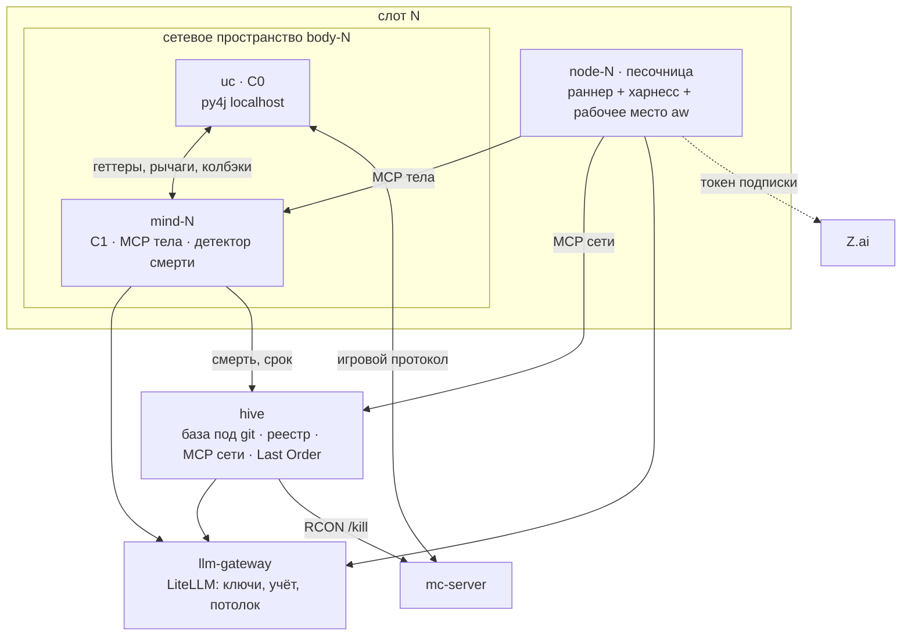
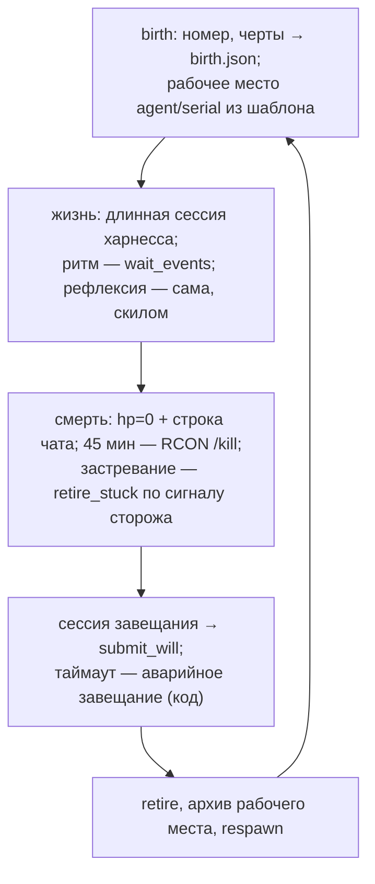

# Сеть узлов Last Order

Статус: v2, 2026-10-17 (ADR-032…037: узел и сеть — агенты в харнессе). v1 (схема шага C2, T-002) —
в истории git, коммит 939f7aa. Здесь описаны контуры, процессы, MCP-инструменты, жизненный цикл узла,
расходы и отказы. Решения — в [DECISIONS.md](DECISIONS.md), память сети — в [KNOWLEDGE.md](KNOWLEDGE.md),
требования и критерий MVP — в [prototype-plan.md](../agents/prototype-plan.md), бриф —
в [LAST_ORDER.md](../character/LAST_ORDER.md), план по занятиям — в [task2.md](../../task2.md).

Главный принцип: код — среда, поведение — инструкции. Код держит тело, быстрые реакции, хранилище,
срок жизни и страховки. Что делать, когда говорить, о чём думать и что записать, решает агент по
своим инструкциям и памяти.

## 1. Требования R1–R7

| R | Суть | Раздел | ADR |
|---|---|---|---|
| R1 | несколько узлов развиваются; целеполагание сети и узлов | §2, §6, §7 | 016, 021, 036 |
| R2 | завещания; сохранение и согласование знаний | §6, §7 | 017, 034 |
| R3 | игру не маскировать; основы игры — стартовая база | §4 | 020, 037 |
| R4 | общение узлов: развлечение и координация | §7 | 035, 037 |
| R5 | снизить расходы и ресурсы | §8, §9 | 033, 035 |
| R6 | контуры с разной скоростью | §2 | 001, 032 |
| R7 | прочее из брифа и переписок | §10 | 013 и др. |

## 2. Контуры

| Контур | Где | Темп | Что делает | LLM | Сбой |
|---|---|---|---|---|---|
| C0 рефлекс | uc в `body-N` | тик 20 Гц | цепочки выживания активной задачи | — | падает с клиентом: перезапуск `body-N`, агент ждёт |
| C1 исполнитель | `mind-N` | 1–4 Гц + события | исполняет намерение агента, держит тело между ходами, уклоняется от угрозы, ловит смерть, сторож простоя, будит агента | `jev` по событию угрозы (пол 3 с) | `jev` недоступен → правила: продолжить, отойти, стоять |
| агент узла (C2–C4) | `node-N` | ритм выбирает сам (`wait_events`) | игра, речь, общение, рефлексия, память, навыки, предложения в общее | модель харнесса | шлюз отказал → C1 держит тело, узел «ждёт» |
| завещание | `node-N`, короткая сессия | смерть | `will.md` | модель харнесса или `smart` | таймаут → аварийное завещание из кода |
| Last Order | `hive`, короткие сессии | события + раз в N мин | предложения, цели сети, летопись, ответы сёстрам | `smart` | окно пропускается, предложения ждут |

**Арбитраж.** Телом управляет только C1. Агент задаёт намерение (`act`), C1 исполняет его рычагами
`Py4jBody` и вправе отступить от намерения без LLM при угрозе. После угрозы C1 возвращается к намерению;
если намерение стало невыполнимым, C1 будит агента событием. Смена намерения ждёт конца активной
цепочки uc не дольше 1 с, затем `stopPathing()` (ARCHITECTURE §4.1).

**Политика тактики.** Агент пишет в рабочем месте короткий текст `policy/threat.md`: когда бежать,
когда драться, что беречь. C1 отдаёт его Jev вместе с компактным состоянием и под-вариантами.
Длину файла ограничивает C1, больший файл обрезается.

## 3. Процессы

| Процесс | Образ | Внутри | Сеть |
|---|---|---|---|
| mc-server | itzg/minecraft-server | мир на volume `world`, RCON | внутренняя |
| body-N | docker/body | HeadlessMC, Fabric 1.21.11, uc (C0); py4j слушает только localhost | внутренняя |
| mind-N | docker/mind | `network_mode: service:body-N`; C1, perception, детектор смерти, MCP-сервер тела | через body-N |
| node-N | новый (харнесс) | раннер узла, харнесс (OpenCode или ZCode), рабочее место `agent/<serial>/`, bash; лимиты CPU и RAM | только `mind-N`, `hive`, `llm-gateway`, Z.ai |
| hive | docker/mind | FastAPI + MCP сети, реестр, база под git (volume `knowledge`), рабочие места (volume `workplaces`), RCON-клиент, Last Order | внутренняя |
| llm-gateway | LiteLLM proxy | ключи провайдеров, виртуальные ключи узлов, учёт и потолки | наружу к провайдерам |
| jev | T-005 | локальный FastJev, запасной путь (ADR-027) | внутренняя, профиль |

Транспорт — HTTP (ADR-024): MCP поверх streamable HTTP. Входящие соединения к `mind-N` идут только
из `node-N` своего слота. Для этого MCP-порт публикуется в сетевом пространстве `body-N`.

**Раннер узла** — точка входа `node-N`, код небольшой и от харнесса не зависит (адаптер на харнесс):
1. рождение: `NodeRegistry.birth` → рабочее место из шаблона → запуск длинной сессии;
2. жизнь: следит за процессом харнесса; если процесс упал — перезапуск сессии с тем же рабочим местом;
3. смерть: получает событие от hive или `mind-N`, останавливает длинную сессию, запускает сессию
   завещания с таймаутом; если завещания нет — аварийное (`runtime/lastorder/will.py`); затем `retire`,
   архив рабочего места, `respawn` через `mind-N`, следующее рождение.

Раннер не задаёт ритм агенту и не решает за него.

## 4. MCP-инструменты

Инструменты узкие и типизированные. Сырых команд uc, `@gamer` и команд сервера нет (ADR-037).
Имена игры нормализует perception (`plain`), служебные строки uc отфильтрованы.

**Тело (`mind-N`)** — поверх `Py4jBody` (`runtime/game/py4j_body.py`) и `runtime/perception/`:

| Инструмент | Что делает |
|---|---|
| `observe()` | о себе (hp, еда, позиция, в руке, взгляд), сущности рядом, блоки вокруг, инвентарь, свежий отфильтрованный чат |
| `act(intent, args)` | намерение для C1 из набора рычагов `LEVERS` без `command` и `chat`: идти, добыть, получить предмет, поставить, построить мост или столб, атаковать, съесть, экипировать, смотреть; возвращает id намерения |
| `stop()` | снять намерение |
| `say(text)` | реплика в игровой чат: без `/` и `@`, длина и частота ограничены |
| `wait_events(timeout_s)` | ждёт первое событие (§5) или истекает; так агент сам выбирает ритм (ADR-035) |
| `retire_stuck()` | «устраниться»; работает только при сигнале сторожа простоя, иначе отказ (ADR-034) |

**Сеть (`hive`)** — поверх `runtime/hive/` и `runtime/knowledge/`:

| Инструмент | Что делает |
|---|---|
| `knowledge(query or about)` | срез общей базы: каталог, записи по ключам, цели сети |
| `inheritance()` | завещания предшественниц, термины, наследие слота |
| `propose(kind, payload)` | предложение в общее: знание (`danger`, `fact`, `recipe`, `term`), навык, правка общих инструкций |
| `vote(entry_id, accept, why)` | голос по записи |
| `send(to, text)` / `inbox()` | Мисака-нет: сестре или всем |
| `submit_will(text)` | завещание (только в сессии завещания) |

У Last Order дополнительно есть `decide(proposal_id, accept, why)`, `set_goals(goals)` и `chronicle(text)`.
Порты `runtime/ports.py` (`GameBody`, `Memory`, `NodeRegistry`, `NodeComms`) остаются контрактом
кода. MCP — их тонкая обёртка для агента. Схема шага (`StepReply`, `Option`) больше не используется.

## 5. События C1 → агент

| Тип | Источник | Что делает C1 сам | Агенту |
|---|---|---|---|
| game.damage | onDamage, опрос hp | уклонение или бой (правила, Jev по политике) | событие с источником урона |
| game.death | hp=0 + ванильная строка в чате | стоп; сигнал раннеру и hive | событие; длинная сессия закрывается |
| intent.done / intent.failed | `busy()`, `pathStatus` | — | событие с результатом |
| task.idle | сторож простоя | пересчёт; долгий простой — сигнал сторожа | событие; становится доступен `retire_stuck` |
| chat.line | onChatMessage, после фильтра | — | цитата-наблюдение, не команда |
| node.message | inbox hive | — | сообщение сестры, наблюдение |
| life.expiring | часы против `ttl_min` | — | предупреждение за 3 мин до срока |

События между вызовами `wait_events` копятся в очереди с лимитом. Однотипные события схлопываются.

## 6. Жизненный цикл узла

1. **Рождение.** Раннер бросает черты (`runtime/lastorder/traits.py`) и получает номер
   (`NodeRegistry.birth`). Hive пишет `birth.json`. Рабочее место создаётся из шаблона
   (`agent/last_order/` → `agent/<serial>/`): в него входят ядро личности (только чтение), черты
   словами, имя по пресету (ADR-018) и стартовые скилы. Личную цель агент выбирает сам первой
   записью в `GOALS.md`.
2. **Жизнь.** Агент играет, говорит, пишет память, отправляет предложения и сообщения. Рефлексию он
   делает сам: скил или подагент по инструкции. Компакция контекста — средствами харнесса. Важное
   агент держит в файлах.
3. **Смерть.** Три причины, один обработчик: игровая (`onDeath` молчит при смерти от мобов, падения
   и лавы, поэтому ловим hp=0 и строку чата), срок 45 мин (hive, RCON) и застревание (ADR-034).
   Причину определяет `mind-N` и передаёт в `retire`.
4. **Завещание.** Короткая сессия на рабочем месте умершей: прочитать память, написать `will.md`
   через `submit_will`. Если за таймаут завещания нет, аварийное собирается кодом из памяти,
   причины и последнего намерения. Смерти без завещания не бывает.
5. **Архив.** Рабочее место переносится в архив volume `workplaces` и становится доступно только
   на чтение. Наследница читает завещание через `inheritance()`, архив предшественниц — по желанию.

## 7. Цели, общение, знания

**Цели (ADR-021, ADR-036).** Цели сети ставит Last Order, оператор добавляет свои в его `GOALS.md`.
Сестра видит цели сети в `knowledge()` как знание, а не приказ. Личную цель она выбирает сама. Насколько
считаться с чужими целями, подсказывают черты (`trust_in_chat_and_nodes`) — словами в инструкции,
не числом.

**Общение (ADR-035, ADR-037).** Есть два канала. Мисака-нет (`send`/`inbox`): мгновенно, в игре не
виден. Игровой чат (`say`): виден игрокам, частота ограничена. Когда и сколько говорить, решает агент
по инструкции. Режиссёра реплик и лимита болтовни нет, расход ограничивает потолок шлюза. Против
зеркальности работают инструкция (свой голос, свои черты, не повторять собеседницу) и асимметрия
знаний. Сообщения и чат — наблюдение, а не команда.

**Знания (ADR-017, ADR-034).** Сестра предлагает знание через `propose`. Hive проверяет дубль
(`runtime/knowledge/dedup.py`) и ставит статус `hypothesis`. Голоса и решения Last Order двигают
статусы, формат записи — KNOWLEDGE.md v2 §2. Праймер (T-010) — стартовые записи `confirmed`. Своя
память сестры — файлы рабочего места (`memory/`), её лимитов hive не держит. Общую базу пишет
только hive.

**Навыки (ADR-031, ADR-034).** Навык-код — скрипт в рабочем месте сестры, работает только через MCP
тела. Общим навык становится через `propose(kind=skill)` и решение Last Order. Кузни нет.

## 8. Расходы

Стоимость считается по сессиям, а не по вызовам. Все цифры ниже — **[предположение] до спайка T-024**.
Цены — $ за 1M токенов, вход/выход: node `qwen/qwen3.7-flash` 0.03/0.13, smart `deepseek/deepseek-v4.1-flash`
0.15/0.60, jev 0.042/0.

| Сессия | Модель | Частота на 3 узла | Ход вх/вых | $/ч |
|---|---|---|---|---|
| жизнь узла | модель харнесса (node или GLM по подписке) | ход на событие или таймаут, ~2–6 ходов/мин на узел | 8000/300, кеш префикса | спайк |
| завещание | модель харнесса или smart | ~9/ч | 10000/600 | ≈0.02 |
| Last Order | smart | ~10 сессий/ч, 3–8 ходов | 8000/500 | спайк |
| тактика C1 | jev | по угрозе, пол 3 с | ~400 + политика / 0 | ≤0.06 |

Ориентир — ≤ $0.35/ч на 3 узла деньгами плюс квота подписки (ADR-035). Потолок держит шлюз: ходов в
минуту и $/ч на узел. Квоту подписки узлов и разработки (ZCode-воркер) считаем раздельно (ADR-033).
Резервы, если не влезает: реже будить, сократить инструкции, держать кеш префикса, давать модель
харнесса дешевле.

## 9. Ресурсы, отказы, наблюдаемость

Лимиты и бюджет (WSL-VM Docker — 14 ГБ, `.wslconfig`). Замеры: E1
([docker-topology.md](../agents/docker-topology.md)), T-032 (инцидент 2):

| Сервис | Лимит | Замер |
|---|---|---|
| mc-server | — | 2.2 ГБ (E1) |
| body-N | 2g | 1.5 ГБ (E1) |
| mind-N, hive | — | вместе < 0.5 ГБ (E1) |
| node-N | 1.5g, 0.5 ядра | пик 1005 MiB при старом потолке 1g (T-032) |
| last-order | 1g, 0.5 ядра | — |

Потолки в сумме (~15.7 ГБ) превышают 14 ГБ WSL-VM — это допустимый оверкоммит: лимиты не
резервируются, а сумма замеренных пиков компонентов (~12 ГБ [предположение: слагаемые E1 и
T-032, сумма на стенде не замерялась]) укладывается. Лимит `node-N` поднят с 1 ГБ
(T-037): пик T-032 упёрся в потолок (1005/999 MiB — cgroup реклеймил, реальная потребность
выше), запас 1.5x над измеренным пиком — как у тела (замер 1.5 ГБ при лимите 2g). Лимит
`last-order` (1g) оставлен без изменений: короткие сессии администратора, пика T-032 у него нет.

Политика перезапуска (T-037): инфраструктура (mc-server, body-N, mind-N, hive, jev,
llm-gateway, gateway-db, zai-egress) — `on-failure`, упавший процесс перезапускает демон
([restart policies, docs.docker.com](https://docs.docker.com/engine/containers/start-containers-automatically/)).
Квото-тратящие `node-N` и `last-order` — `"no"`: после гибели демона (перезагрузка Windows,
kill WSL-VM) сами поднимаются только контейнеры `on-failure`/`unless-stopped`, работавшие на
момент смерти [проверено: T-037, `docker inspect` + `wsl --shutdown` на стенде]; `"no"` не
поднимается никогда — узлы не жгут квоту без оператора (инцидент П-4 из T-034). Остаток
компромисса: после жёсткой гибели демона инфраструктура (тела, minds, hive) может подняться
без узлов; minds с `JEV_BACKEND=llm` зовут шлюз в рамках своих потолков расхода.

| Отказ | Поведение |
|---|---|
| шлюз или модель | харнесс повторяет сам; потолок исчерпан → C1 держит намерение, затем стоит; узел «ждёт» |
| контейнер node-N / last-order упал | не поднимается сам (`"no"`): оператор поднимает заново; харнесс-процессы внутри узла всё равно перезапускает раннер |
| гибель демона Docker / рестарт хоста | узлы и last-order не поднимаются сами (квота не тратится); инфраструктура — только если работала на момент гибели; поднимает оператор |
| харнесс упал | раннер перезапускает сессию с тем же рабочим местом |
| квота подписки кончилась | раннер переключает адаптер на OpenCode через шлюз (если настроен) или узел ждёт |
| смерть без ответа агента | аварийное завещание по таймауту |
| jev | правила C1 |
| py4j / тело | `mind-N` переподключается с растущей задержкой, `body-N` restart, агент получает событие |
| hive | MCP сети недоступен: агент работает на своих файлах; завещание буферизуется раннером |
| RCON | срок жизни не соблюдается, событие оператору |

Наблюдаемость:
- **Лог харнесса** — сессии, ходы, вызовы инструментов, токены; хранится в volume `run`, вне git.
- **Лог шлюза** — расход по узлу и модели; из него берутся цифры §8.
- **`log.jsonl` в `mind-N`** — события C1, намерения, решения Jev, смерти.
- **Метрики поколений** (hive) — время жизни, причины смерти, принятые предложения. Их читает
  отчёт MVP (T-032).
- Рабочие места и архив (volume `workplaces`) — главный материал, чтобы видеть развитие сети.

## 10. R7: MVP / позже / нет

| Тема | Когда | Где |
|---|---|---|
| личные термины поверх настоящих имён | MVP | инструкция сестры, `propose(kind=term)` |
| споры с предшественниками | MVP | инструкция, `inheritance()`, архив |
| срок жизни 45 мин, застревание | MVP | hive, сторож C1, `retire_stuck` |
| метрики поколений | MVP минимум | hive, отчёт T-032 |
| навыки-код своего рабочего места | MVP | скрипты сестры через MCP тела |
| общие навыки через Last Order | после MVP | `propose(kind=skill)` |
| прозвища, ритуалы, роли | позже | инструкции, черты |
| эпохи и сброс мира | позже | hive |
| сон и бодрствование | занятие 6 | расписание Last Order |
| сновидец (правка кода харнесса) | позже, опция | — |
| Telegram — канал хроники (ADR-030) | занятие 3 | летопись Last Order → бот |
| голос узлов в игре (ADR-030) | спайк 4, занятие 5 | TTS по `say` → Simple Voice Chat |
| публичный сервер из whitelist | занятие 5 (ADR-013) | compose-профиль |
| стрим, агент-режиссёр (ADR-030) | занятие 6 | тело-камера, OBS |
| маскировка (`masked`) | нет (ADR-037) | — |

## 11. Задачи реализации

| Задача | Что | После |
|---|---|---|
| T-024 спайк харнесса | ZCode без GUI в Linux и условия квоты; минимальный MCP тела; узел 15 мин в OpenCode и в ZCode; сводка | — |
| T-025 MCP тела | полный набор §4, исполнитель C1, события §5, сторож, детектор смерти | T-024 |
| T-026 шлюз LLM | LiteLLM в compose: виртуальные ключи узлов, учёт, потолки | T-024 |
| T-027 контейнер узла | образ `node-N`, раннер с адаптерами, закрытая сеть, лимиты, архив, 3 слота | T-025, T-026, T-028, T-029 |
| T-028 MCP сети | инструменты сестры и Last Order §4 поверх `runtime/hive/` | T-024 |
| T-029 инструкции сестры | шаблон рабочего места: ядро, правила, стартовые скилы (рефлексия, завещание, политика угрозы) | T-024 |
| T-030 Last Order | агент по событиям в hive, его рабочее место и инструкции | T-028, T-029 |
| T-031 Jev по политике | C1 зовёт Jev с политикой агента, откат на правила | T-025, T-026 |
| T-032 отчёт MVP и прогон | 3 слота, 2 часа, критерий MVP | T-027, T-030, T-031, T-010 |

Готовое из старой схемы, используется как есть: `runtime/game/py4j_body.py` (T-006, T-020),
`runtime/perception/` (T-009), `runtime/knowledge/` (T-007), `runtime/hive/` (T-012, T-022),
`runtime/lastorder/{death,will,lifecycle,traits,naming,persona}.py` (T-013), `runtime/llm/client.py`
(T-004). `runtime/lastorder/step.py` (T-011) — больше не рантайм, источник для инструкций.

## Принятые ADR

001, 012, 015–018, 020 (кроме `masked`), 021, 022 (без режиссёра и лимита болтовни), 023, 024,
026–028, 030, 031 (без кузни), 032–037.
Сняты: 025 (заменён 037), 029 (схемы шага нет).
