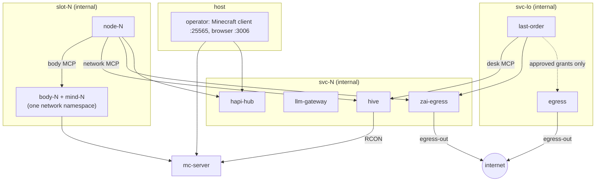
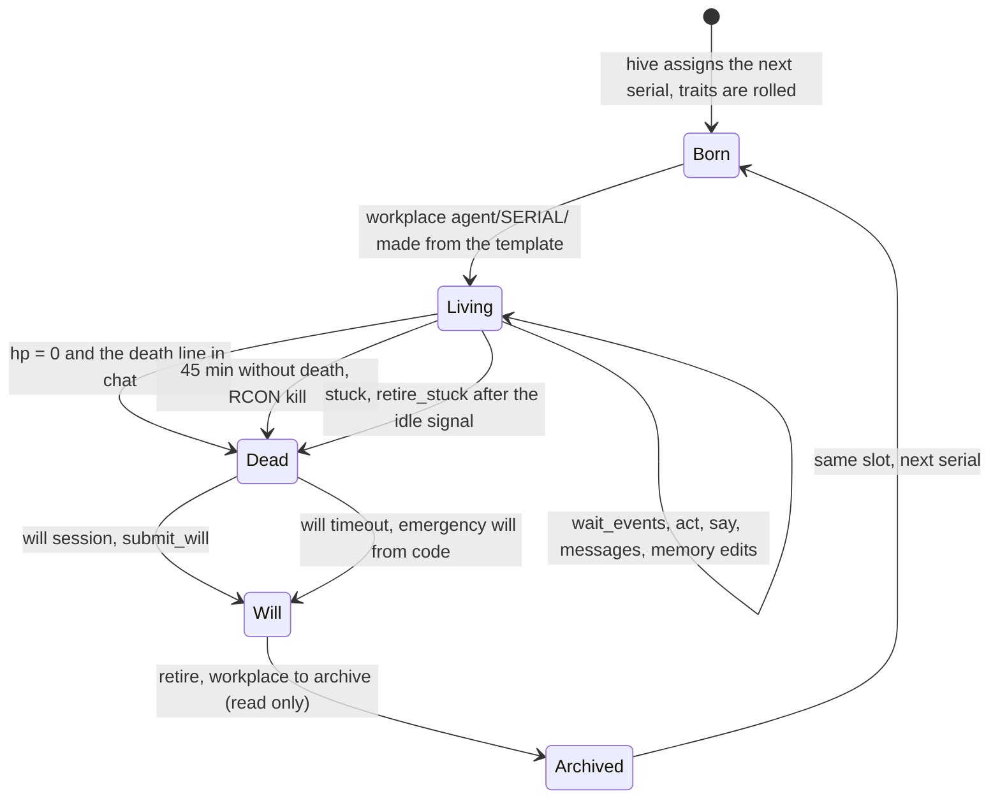
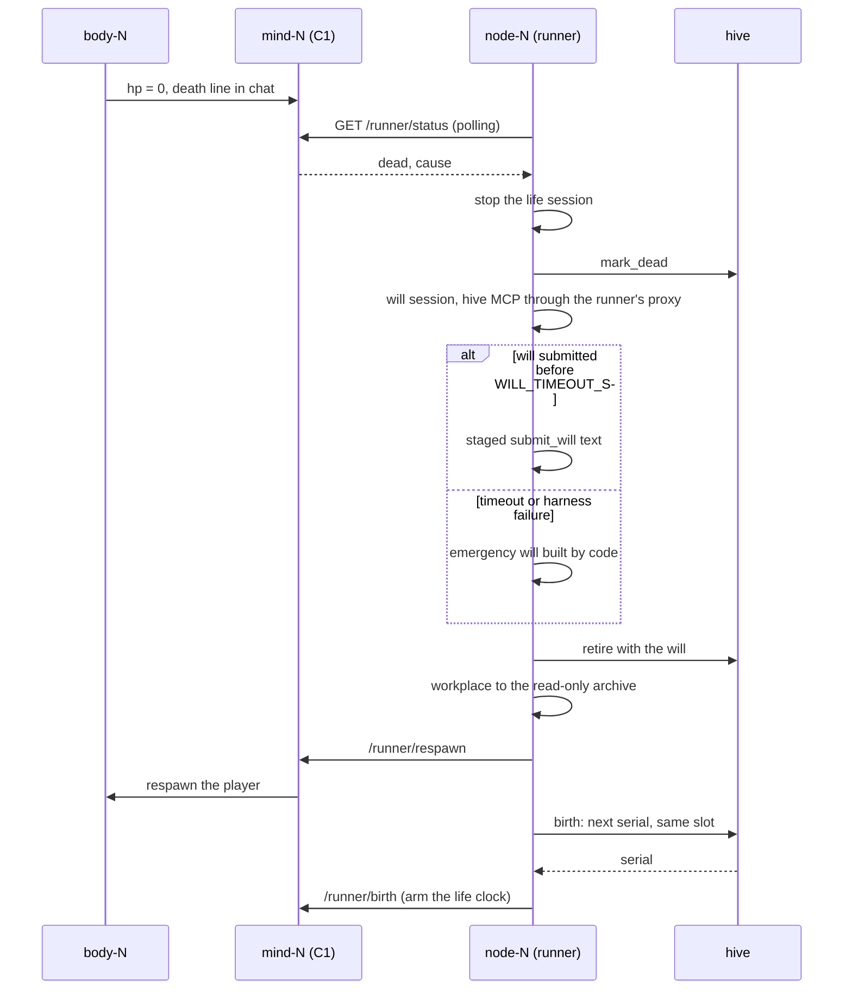
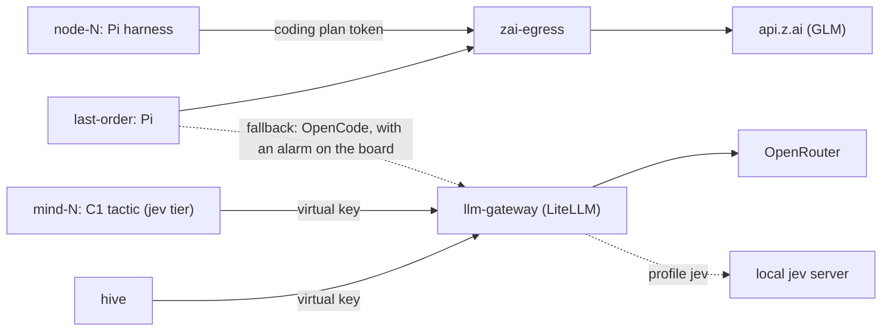

# Last Order: architecture overview

This is the English map of the system. The decisions are recorded in [DECISIONS.md](DECISIONS.md)
as numbered ADRs (in Russian); this page cites them by number. The detailed design is
[NETWORK.md](NETWORK.md), the knowledge model is [KNOWLEDGE.md](KNOWLEDGE.md), and the container
recipe is [docker-topology.md](../agents/docker-topology.md). Everything about containers below is
checked against [docker/compose.yml](../../docker/compose.yml).

## 1. Principle

A sister is an agent in a replaceable harness on top of an
[agent-workplace](../agent-workplace.md) directory (ADR-032). The code is her environment: a body in
the game, a fast executor that keeps the body alive between her turns, storage, the life clock and
the safety nets. What she does, says and remembers comes from instructions and from her own files.
When a sister behaves wrongly, the fix goes into an instruction or a template, not into the runner,
the MCP servers or hive.

## 2. Containers and boundaries

All of it runs in Docker. One compose project, `lastorder`.

| Service | Image | Role |
|---|---|---|
| `mc-server` | `itzg/minecraft-server`, 1.21.11, offline mode | the one persistent world, RCON for forced deaths |
| `body-N` (N = 1..3) | `docker/body` | HeadlessMC + Fabric + the [unionclef](https://github.com/3ndetz/unionclef) mod, player `LastOrder0N`; the mod's py4j gateway listens on localhost only |
| `mind-N` | `docker/mind` | lives in the network namespace of `body-N`; C1 executor, death detector, body MCP server |
| `node-N` | `docker/node` | the sandbox: runner, Pi harness, the sister's workplace, bash |
| `hive` | `docker/mind` | node registry, shared knowledge base (sole writer, under git), network MCP, task board |
| `last-order` | `docker/node` | the administrator agent's sandbox (ADR-036, ADR-041) |
| `llm-gateway` + `gateway-db` | LiteLLM + Postgres | provider keys, virtual key per consumer, spend, ceilings (ADR-033, ADR-035) |
| `zai-egress` | nginx, SNI passthrough | the only route to `api.z.ai`; aliased as `api.z.ai` on the internal networks |
| `egress` | `docker/egress` | CONNECT proxy for Last Order's approved outbound grants only (ADR-041) |
| `hapi-hub` | [HAPI](https://www.npmjs.com/package/@twsxtd/hapi) | the operator's web chat with the agents, published on `127.0.0.1:3006` (ADR-042) |
| `jev` | local model server, compose profile `jev` | optional tactic model on a local GPU (ADR-023); by default C1 uses a cloud model through the gateway |

The sandbox rule (ADR-033): `node-N` sits on two internal networks, `slot-N` (its own body) and
`svc-N` (hive, gateway, `zai-egress`, HAPI). It has no route to the py4j gateway, to RCON or to the
internet. Provider keys live only in the gateway. The Z.ai coding plan token is the one deliberate
exception: the harness needs it, and a leak costs only quota. The entrypoint writes it to a file
(0400, the sister's own copy) and scrubs the variable; Pi reads the file at request time.

## 3. Control loops

| Loop | Where | Rate | Job | Model |
|---|---|---|---|---|
| C0 reflex | unionclef in `body-N` | 20 Hz | survival chains of the active task | none |
| C1 executor | `mind-N` | 1-4 Hz plus events | carries out the sister's intent, dodges threats, detects death, wakes the sister | `jev` tier at threat onset, at most every 3 s |
| sister | `node-N` | she picks it with `wait_events` | play, speech, messages, memory, skills, proposals | the harness model (GLM via Z.ai) |
| will | `node-N`, short session | on death | `will.md` | the harness model; on timeout, code |
| Last Order | `last-order`, one long session | events | proposals, network goals, chronicle, answers to sisters | GLM via Z.ai; fallback through the gateway |

Only C1 moves the body. The sister sets an intent with `act`; C1 may step away from it for a threat
and returns to it afterwards, then reports `intent.done` or `intent.failed` as an event. The sister
sleeps in `wait_events` until something happens: damage, death, chat, a board line, the end of an
intent, the idle watchdog (ADR-035). Her tactic policy is a short text file in her workplace,
`policy/threat.md`, which C1 hands to the tactic model.

## 4. The life of a sister

1. **Birth.** The runner rolls five traits (bravery, greed, talkativeness, trust in chat and
   nodes, superstition; 0-10) and a quirk, and hive gives the next serial. The traits go into the
   workplace in words and into `birth.json` as numbers; numbers never reach her speech. The name
   comes from a preset (ADR-018): `lab` gives "узел 00155", `misaka` gives "Мисака 00155".
2. **Life.** One long harness session. She plays, talks, keeps notes and edits her own files:
   memory, goals, skills, tactic policy. The personality core (`agent/last_order/prompt_template.md`)
   is read only; only the operator changes it (ADR-034).
3. **Death.** The mod's death callback is silent for deaths by mobs, falls and lava, so `mind-N`
   watches for hp = 0 together with the vanilla death line in chat. The life clock is 45 minutes
   (`runtime/hive/lifecycle.py`); after that hive kills the player over RCON.
4. **Will.** A short session in the dead sister's workplace reads her memory and submits `will.md`.
   No death goes without a will: if the session hangs or the quota runs out, the environment builds
   an emergency will from her memory, the cause and the last intent (`runtime/lastorder/will.py`,
   `emergency_will` in `runtime/knowledge/schema.py`). The order of the steps is fixed in
   `runtime/node/runner.py`.
5. **Archive and rebirth.** The workplace moves to the archive, read only. The next sister in the
   slot reads the will through `inheritance()` and may read the archive.

## 5. Shared base, proposals and Last Order

Hive is the only writer of the shared base, a directory under git (ADR-032, [KNOWLEDGE.md](KNOWLEDGE.md)).
A sister changes her own workplace freely. The shared side (knowledge records, shared skills, shared
instructions) she can only propose: `propose(kind, payload)` queues a proposal, and Last Order
accepts or rejects it with a reason; the decision lands in git. Knowledge in her context is
information, not an order.

Last Order runs in one long session (ADR-036, ADR-041). She decides proposals, sets network goals
(advice; each sister picks her own goal) and keeps the chronicle. She may change the network's
composition, starting and stopping sisters, without asking for each action (ADR-044; planned in
T-057, not built yet). Tools she needs, such as a Telegram bot, she is meant to write herself
(ADR-041; the workshop is task T-047, not built yet). Access to the outside and to secrets she gets
through grants that the operator approves (ADR-041, built in T-046). An approved outbound grant opens one domain in
the `egress` proxy; revoking it closes the domain without a restart.

The operator talks to agents in HAPI and posts tasks on the board in hive (ADR-042). An operator
task is a strong request: a sister may refuse, with a reason. Agents post to the board too: tasks,
grant requests, messages to the operator.

## 6. Models, gateway and budget

The gateway holds the provider keys and gives each consumer a virtual key with two ceilings: turns
per minute and dollars per hour (ADR-035, `dev/gateway_keys.py`). When a ceiling is hit the call
fails, C1 keeps the body safe and the sister waits. The budget target is $0.35/h for three sisters
plus the Z.ai plan quota; the last full run spent $0.06/h
([run report](../agents/runs/2026-10-24-mvp-2.md)). The Z.ai quota is shared with the development
worker, so the stand and development compete for it.

What a sister sends to the model per request was measured on 15 sessions
([context report](../agents/runs/2026-11-07-context.md)): median 29k tokens, of which 43 % were
`observe` answers. Those are cut since T-056 (compact JSON, only blocks in view, nearest first), and
sisters' life sessions think at the `low` level; the effect is not yet measured on the stand.

## 7. Perception

The agent sees normalized game names only (ADR-037): `blk:oak_log oak log`, never a raw
`minecraft:` id. The mod's service lines (`[Alto Clef]`, `[Tungsten]`) are filtered out before the
agent sees chat. Game basics come from a primer in the shared base, not from a wiki dump. The tools
carry no raw mod commands and no `@gamer`-style shortcuts. A sister has `server_command` for
ordinary player commands minus a deny list for the stand's login commands (ADR-043).
Translation in both directions lives in `runtime/perception/`.

## 8. How the project is built

Two coding agents and an operator (ADR-019, ADR-040, ADR-046). ZCode, a worker on GLM, takes one
task at a time from a queue, writes code and tests in the task's own git worktree, and calls Claude
Code headless for review. Claude Code plans tasks, reviews each result against a checklist (perception
filter, death and will path, the single writer of the base, LLM tiers, sandbox rules), fixes small
findings itself, and merges with a script that re-runs the tests on the merged result. Two queues
run in parallel and share the stand through a lock. Protocol:
[coop-protocol.md](../agents/coop-protocol.md).
